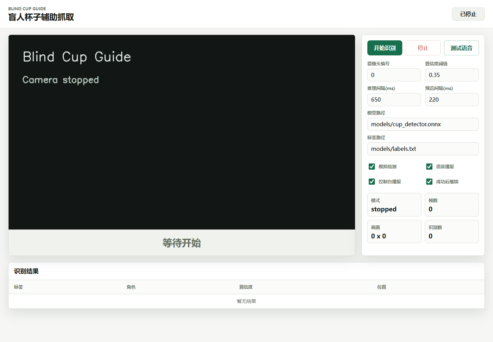

# Blind Cup Guide C++ · 杯子辅助抓取原型

使用摄像头观察桌面上的杯子与手，通过目标检测和中文语音提示，演示“寻找杯子 → 向左/右调整 → 接近目标”的辅助抓取流程。项目使用 C++17、OpenCV DNN 和浏览器控制界面，适合研究视觉交互、ONNX 推理与语音反馈的集成。

仓库已包含 `cup`、`hand`、`other` 三类的 ONNX 模型，也提供模拟检测模式，方便先理解引导逻辑。

## 界面预览



截图来自实际编译运行的 Web 控制台，处于等待开始状态，未开启摄像头；不是识别效果或真实抓取成功的展示。

## 功能

- 浏览器中开始/停止识别、选择摄像头、切换模拟检测和语音播报。
- 显示摄像头画面、检测框、分类结果、当前提示和运行状态。
- 使用 OpenCV DNN 加载仓库附带的 ONNX 模型。
- 根据杯子与手的位置输出“往左边一点”“往右边一点”等提示。
- Windows 支持 SAPI 语音；其他平台或 `--console-tts` 模式输出提示文本。
- 保留带 OpenCV 窗口的命令行调试模式。

## 获取项目与准备环境

需要 Git、CMake 3.20+、C++17 编译器和 OpenCV 4 开发库。OpenCV 组件需包含 `core`、`videoio`、`highgui`、`imgproc`、`imgcodecs`、`dnn`。开始识别还需要可用摄像头，**`--mock` 只替换检测结果，不替换摄像头输入**。

```sh
git clone https://github.com/wqyorxyq/BlindCupGuideCpp.git
cd BlindCupGuideCpp
```

若仓库仍为私有，需要先获得访问权限并完成 GitHub 身份认证。

## Windows 构建与运行

准备 Visual Studio 2022 或更新版本的“使用 C++ 的桌面开发”工作负载及 Windows SDK。下面将 vcpkg 放到仓库内的 `tools/vcpkg`，所有命令均从项目根目录执行：

```powershell
git clone https://github.com/microsoft/vcpkg.git tools/vcpkg
.\tools\vcpkg\bootstrap-vcpkg.bat
.\tools\vcpkg\vcpkg.exe install opencv4:x64-windows
cmake -S . -B build -A x64 -DCMAKE_TOOLCHAIN_FILE=tools/vcpkg/scripts/buildsystems/vcpkg.cmake
cmake --build build --config Release
.\build\Release\blind_cup_guide.exe --mock
```

首次安装 OpenCV 可能需要较长时间。默认使用已安装的 Visual Studio 生成器；如果电脑上有多个版本，可在配置命令中用 `-G` 指定对应生成器。

程序会打开 **http://127.0.0.1:8080/**。启动后保持终端运行，在网页点击“开始识别”。首次体验建议开启模拟检测；确认流程后关闭模拟检测，使用仓库内的真实模型。

如果提示找不到 OpenCV DLL，检查构建输出中的依赖复制结果；也可在当前 PowerShell 会话中添加本次安装的依赖目录：

```powershell
$env:PATH = (Resolve-Path 'tools/vcpkg/installed/x64-windows/bin').Path + ';' + $env:PATH
.\build\Release\blind_cup_guide.exe --mock
```

## Linux / macOS 构建与运行

先安装 C++ 编译器、CMake 和 OpenCV 开发库。例如 Ubuntu/Debian 可使用系统软件包：

```sh
sudo apt-get update
sudo apt-get install build-essential cmake libopencv-dev
```

macOS 可先安装 Xcode Command Line Tools，再通过 Homebrew 安装 `cmake` 和 `opencv`。依赖就绪后，从仓库根目录执行：

```sh
cmake -S . -B build -DCMAKE_BUILD_TYPE=Release
cmake --build build --parallel
./build/blind_cup_guide --mock --console-tts
```

以上单配置构建方式的可执行文件位于 `build`；Windows 多配置构建位于 `build/Release`。请始终从仓库根目录启动，使默认模型和标签相对路径能够正确解析。Linux/macOS 的运行步骤尚未逐平台实测，原生语音功能仅在 Windows 实现。

## 第一次体验

1. 运行程序并打开控制台，选择可用的摄像头编号（默认 0）。
2. 启用模拟检测并开始识别，观察提示和检测表；模拟框不对应真实物体。
3. 停止识别、关闭模拟检测，再开始使用附带模型。
4. 在镜头中放入杯子与手，观察“未看到杯子”“请把手放到画面中”及左右调整提示。
5. 完成后停止识别；在启动服务的终端按 Enter 结束 Web 服务。

## 常用运行选项

| 参数 | 作用 |
| --- | --- |
| `--mock` | 使用模拟检测结果；仍需要摄像头 |
| `--camera 1` | 选择编号为 1 的摄像头 |
| `--console-tts` | 仅输出语音文本 |
| `--port 8081` | 修改 Web 服务端口 |
| `--no-open-browser` | 启动服务但不自动打开浏览器 |
| `--cli` | 使用 OpenCV 调试窗口模式 |
| `--no-display` | CLI 模式中不显示调试窗口 |
| `--model models/cup_detector.onnx` | 指定 ONNX 模型 |
| `--labels models/labels.txt` | 指定标签文件 |
| `--confidence 0.35` | 设置检测置信度阈值 |
| `--keep-running` | CLI 模式在成功提示后继续运行 |

更多参数可通过 `--help` 查看。模型文件缺失时可退回模拟检测；文件存在但格式不兼容时可能报错，不应把回退模式当作真实模型运行。

## 结构与模型

| 路径 | 内容 |
| --- | --- |
| `src/main.cpp` | 命令行选项和启动入口 |
| `src/WebApplication.cpp` / `src/WebAssets.cpp` | Web 服务交互与内嵌前端 |
| `src/OpenCvDnnObjectDetector.cpp` | ONNX 推理和输出解析 |
| `src/GuidanceEngine.cpp` | 杯子与手的位置关系和引导规则 |
| `src/SpeechSynthesizer.cpp` | Windows SAPI 与文本输出 |
| `include/blind_cup_guide/` | C++ 模块接口 |
| `models/` | 已包含的 ONNX 模型与类别标签 |
| [训练说明](docs/training-notes.md) | 数据要求、训练命令和已有实验记录 |

已有训练记录包含 203 张训练图片、25 张验证图片、26 张测试图片。记录中的 ONNX 验证集 mAP50 为 0.734、mAP50–95 为 0.606；这些是小规模数据上的历史实验结果，不是抓取成功率，也不是本次重新测得的指标。原始数据集及训练检查点未随仓库提供。

## 常见问题与原型边界

- **CMake 找不到 OpenCV**：确认安装的是开发库，并使用上面的工具链配置；仅安装 Python 的 `opencv-python` 不足以编译 C++ 项目。切换工具链时使用新的构建目录。
- **摄像头打不开**：检查系统权限、设备编号以及是否被其他应用占用；模拟检测也需要有效视频输入。
- **模型加载或输出异常**：类别顺序应与 `models/labels.txt` 一致；替换模型时还需核对输出布局与现有解析器是否兼容。
- **“做对了”只是二维框规则的结果**：当前根据框的重叠或中心距离判断接近，无法确认手已实际握住杯子，也不估计深度。
- **左右提示使用图像坐标**：受摄像头安装方向和镜像关系影响，使用前需要核对；当前没有上下、前后方向引导。
- 本项目是辅助交互研究原型，尚不能作为可靠的独立辅助抓取产品。

## 许可证

项目许可证见 [LICENSE](LICENSE)。
